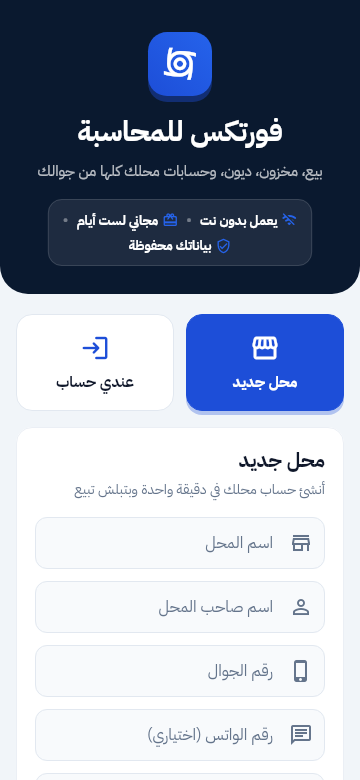
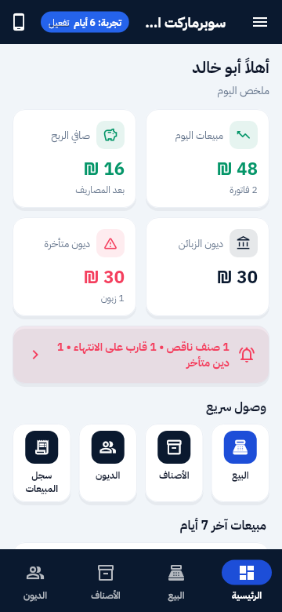
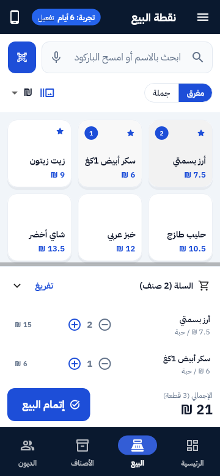
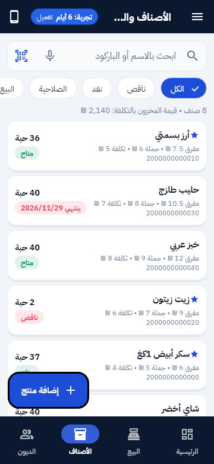

# 🌀 فورتكس للمحاسبة (Vortex)

**بيع، مخزون، ديون، وحسابات محلك كلها من جوالك.**
تطبيق محاسبة متكامل للمحلات، يعمل على **أندرويد وآيفون**، بواجهة عربية كاملة (RTL)، ويعمل **بدون إنترنت** أولاً
(Offline-First) مع مزامنة سحابية ونسخ احتياطي تلقائي.

<p align="center">
  
  
  
  
</p>

---

## ✨ المزايا

| القسم | المزايا |
|---|---|
| **البداية** | إنشاء محل جديد في دقيقة • الدخول برقم الجوال وكلمة السر واسترجاع كل البيانات • تجربة مجانية 6 أيام |
| **نقطة البيع** | بيع بالاسم أو **الباركود** • **شاشة بيع سريعة** للأصناف الأكثر مبيعاً • **بحث صوتي** • مفرق/جملة • خصم • مدفوع أو آجل (دين) بتاريخ استحقاق • **تعدد العملات** (شيكل/دولار/دينار) |
| **ماسح الباركود** | صوت واهتزاز • **مسح متتالي** بدون إغلاق الكاميرا • فلاش وتبديل كاميرا • إدخال يدوي • يدعم قارئ باركود خارجي (بلوتوث/USB) في حقل البحث |
| **الفواتير** | **طباعة حرارية** بلوتوث 58/80 ملم بالعربي • **إرسال الفاتورة عبر واتساب** (نص أو PDF) • طباعة A4 • **المرتجعات** (نقداً أو خصم من الدين) |
| **المخزون** | أصناف بسعر مفرق وجملة • **وحدات متعددة** (حبة/كرتونة...) بباركود وسعر لكل وحدة • **توليد باركود داخلي** EAN-13 وطباعة ملصقات • **تنبيهات الحد الأدنى وتاريخ الانتهاء** • **جرد سريع بالباركود** |
| **المشتريات** | **فاتورة شراء من المورد** تحدّث الكمية و**متوسط التكلفة** • دين المورد ودفعاته |
| **الديون** | زبائن ودفتر حساب • تمييز **الديون المتأخرة بالأحمر المرجاني** تلقائياً • **تذكير واتساب** بضغطة • كشف حساب PDF • سقف دين |
| **الصندوق** | **فتح/إقفال الصندوق اليومي** ومطابقة النقد (عجز/زيادة) • المصاريف |
| **العمال والحماية** | **وضع العامل** بصلاحيات مفصّلة • **رمز المالك** يحمي الأرباح والتعديلات • **قفل بالبصمة/الوجه** • **سجل عمليات لا يُمحى** (سلسلة تجزئة + منع الحذف) |
| **التقارير** | **رسوم بيانية** للمبيعات والربح • الأكثر مبيعاً والأكثر ربحاً • الأصناف الراكدة • المصاريف • المبيعات حسب العامل |
| **البيانات** | **نسخ احتياطي تلقائي يومي** • **مزامنة ذكية في الخلفية** مع Supabase • استرجاع كامل على جهاز جديد • **الوضع الليلي** |

### 🎨 نظام الألوان
| اللون | الاستخدام |
|---|---|
| رمادي ثلجي `#F1F5F9` + بطاقات بيضاء `#FFFFFF` | الخلفية والبطاقات |
| كحلي ليلي `#0A192F` | الهيدر، القائمة الجانبية، التنقل السفلي، الأزرار الداكنة |
| أزرق كهربائي ملكي `#1D4ED8` | إتمام البيع، مسح الباركود، إضافة منتج، الروابط النشطة |
| أخضر زمردي `#059669` | **حصراً**: صافي الربح، المبيعات المكتملة، "متاح"، "مدفوع" |
| أحمر مرجاني `#F43F5E` | **حصراً**: التنبيهات والديون المتأخرة والنقص |

---

## 🏗️ البنية المعمارية

```
lib/
├── main.dart                  نقطة البداية: فتح القاعدة، المزامنة، الإشعارات
├── app.dart                   MaterialApp عربي RTL + الثيم الفاتح/الليلي
├── core/
│   ├── theme.dart             نظام الألوان الصارم (VColors) والثيمات
│   ├── config.dart            ⚙️ الإعدادات: مدة التجربة، واتساب الدعم، المفتاح السري، Supabase
│   └── format.dart            تنسيق الأرقام والتواريخ، الأرقام العربية، تطبيع البحث
├── data/
│   ├── schema.dart            مخطط SQLite (الجداول، الفهارس، حماية سجل العمليات)
│   ├── db.dart                غلاف القاعدة + طابور المزامنة (Outbox) تلقائياً مع كل كتابة
│   └── models.dart            النماذج: Item, ItemUnit, Sale, CartLine, Customer, Shift ...
├── services/                  ← منطق العمل (مستقل عن الواجهة ومختبر آلياً)
│   ├── session.dart           المحل، المالك، العمال، الرموز، الدخول
│   ├── inventory_service.dart الأصناف، الوحدات، الباركود، حركات المخزون، الجرد، الباركود الداخلي
│   ├── sales_service.dart     إتمام البيع، المرتجعات، سجل الفواتير
│   ├── purchase_service.dart  فواتير الشراء ومتوسط التكلفة المرجّح
│   ├── debts_service.dart     الزبائن، الموردون، الدفتر، الأرصدة، المتأخر (FIFO)
│   ├── cash_service.dart      الورديات/الصندوق والمصاريف
│   ├── report_service.dart    التقارير والسلاسل اليومية
│   ├── currency_service.dart  العملات وأسعار الصرف
│   ├── audit_service.dart     سجل العمليات بسلسلة SHA-256
│   ├── subscription_service.dart التجربة وأكواد التفعيل (تعمل بدون إنترنت)
│   ├── backup_service.dart    نسخ احتياطي يومي + استرجاع
│   ├── sync_service.dart      المزامنة الذكية في الخلفية (Supabase)
│   ├── pdf_service.dart       الفاتورة، كشف الحساب، ملصقات الباركود
│   ├── printer_service.dart   الطباعة الحرارية بالبلوتوث (ESC/POS كصورة لدعم العربية)
│   ├── whatsapp_service.dart  تذكير الديون، إرسال الفواتير، طلب التفعيل
│   └── device_services.dart   البصمة/الوجه، البحث الصوتي، الإشعارات المحلية
├── state/app_state.dart       الحالة العامة (الثيم، الاشتراك، إعادة التحميل بعد التعديل)
└── ui/
    ├── widgets/               بطاقات، شارات الحالة، الرسوم البيانية، المنتقيات، إجراءات الفاتورة
    └── screens/               كل الشاشات (البداية، القفل، الهيكل، البيع، الماسح، ...)
server/schema.sql              قاعدة بيانات المزامنة على Supabase (مع RLS)
tool/gen_activation.dart       أداة توليد أكواد التفعيل
test/                          اختبارات المحاسبة + اختبارات عرض الشاشات
screenshots/                   توليد لقطات الشاشة
```

### كيف تعمل البيانات؟
1. **محلياً أولاً**: كل شيء يُحفظ في SQLite على الجوال، فيعمل التطبيق بالكامل بدون إنترنت.
2. **طابور المزامنة (Outbox)**: كل عملية كتابة تُضاف تلقائياً إلى `sync_queue`.
3. **المزامنة الذكية**: عند توفر الإنترنت (وكل 3 دقائق، وبعد كل تعديل بثوانٍ) يُرفع الطابور على دفعات ثم تُسحب تغييرات الأجهزة الأخرى.
4. **حل التعارض**: آخر تعديل يفوز للبيانات العادية، أما **كميات المخزون فتُحسب من حركات المخزون** والأرصدة من الدفتر — فلا يضيع بيع من أي جهاز.
5. **سجل العمليات**: كل سجل يحمل تجزئة السجل السابق، والقاعدة ترفض الحذف والتعديل (Triggers) محلياً وعلى السحابة.

---

## 🚀 التشغيل خطوة بخطوة

### 1) تثبيت الأدوات
- **Flutter 3.50+**: [docs.flutter.dev/get-started/install](https://docs.flutter.dev/get-started/install)
- **أندرويد**: Android Studio (يثبّت Android SDK)، ثم: `flutter doctor --android-licenses`
- **آيفون**: جهاز **Mac** عليه **Xcode** (من App Store) و CocoaPods: `sudo gem install cocoapods`
- تحقق: `flutter doctor`

### 2) جلب المكتبات والاختبار
```bash
flutter pub get
flutter test          # اختبارات المحاسبة وعرض الشاشات
```

### 3) التشغيل على أندرويد
فعّل **خيارات المطور ← تصحيح USB** على الجوال، وصِله بالكمبيوتر:
```bash
flutter run
```
بناء ملف للتوزيع:
```bash
flutter build apk --release          # ملف APK للتثبيت المباشر
flutter build appbundle --release    # ملف AAB لمتجر Google Play
```
الملف يكون في: `build/app/outputs/flutter-apk/app-release.apk`

> 🔑 قبل النشر على Google Play أنشئ مفتاح توقيع خاص بك
> ([الدليل](https://docs.flutter.dev/deployment/android#sign-the-app)) واستبدل `signingConfig` في `android/app/build.gradle.kts`.

### 4) التشغيل على آيفون (يتطلب Mac)
```bash
cd ios && pod install && cd ..
open ios/Runner.xcworkspace
```
في Xcode: اختر **Runner ← Signing & Capabilities**، سجّل بحساب Apple الخاص بك واختر Team، وغيّر
**Bundle Identifier** إلى معرّف فريد (مثل `com.yourname.vortex`). ثم صِل الآيفون:
```bash
flutter run
```
للنشر: `flutter build ipa` ثم ارفع الملف عبر **Transporter** إلى App Store Connect.

> 💡 **لا تملك Mac؟** ملف `.github/workflows/build.yml` يبني نسخة آيفون (غير موقّعة) تلقائياً على GitHub،
> أو استخدم خدمة بناء سحابية مثل **Codemagic** لتوقيعها ونشرها.

### 5) البناء التلقائي على GitHub
من تبويب **Actions** ← **بناء فورتكس** ← **Run workflow**. ستجد في نهاية التشغيل:
- `vortex-android-apk` ← ملف APK جاهز للتثبيت
- `vortex-ios-unsigned` ← نسخة آيفون غير موقعة

---

## ☁️ تفعيل المزامنة والاسترجاع السحابي (اختياري)

التطبيق يعمل كاملاً بدونها. لتفعيل "عندي حساب" واسترجاع المحل على جهاز جديد:

1. أنشئ مشروعاً مجانياً على [supabase.com](https://supabase.com).
2. **SQL Editor ← New query**: الصق محتوى `server/schema.sql` واضغط **Run**.
3. **Authentication ← Providers ← Email**: أطفئ **Confirm email** (الحساب يُنشأ من رقم الجوال تلقائياً).
4. **Project Settings ← API**: انسخ `Project URL` و `anon/publishable key`.
5. شغّل أو ابنِ التطبيق مع المفاتيح:
```bash
flutter run --dart-define=SUPABASE_URL=https://xxxx.supabase.co --dart-define=SUPABASE_ANON_KEY=xxxx
```
على GitHub أضفها في **Settings ← Secrets and variables ← Actions** باسم `SUPABASE_URL` و `SUPABASE_ANON_KEY`.

**كلمة سر الحساب السحابي = رمز المالك السري** (6 أرقام فأكثر) الذي يُدخل عند إنشاء المحل.

---

## 💳 الاشتراك وأكواد التفعيل

- التجربة المجانية **6 أيام** (قابلة للتعديل في `lib/core/config.dart`).
- بعد انتهائها تبقى البيانات محفوظة ويمكن عرضها، لكن البيع يتوقف حتى التفعيل.
- العميل يضغط **"طلب التفعيل عبر واتساب"** فتصلك رسالة برقم محله.
- ولّد له كوداً (يعمل بدون إنترنت ومرتبط برقم محله):
```bash
dart run tool/gen_activation.dart 0591234567 12     # رقم المحل، عدد الأشهر
```
> ⚠️ **غيّر** `activationSecret` في `lib/core/config.dart` و `secret` في `tool/gen_activation.dart` إلى نفس القيمة السرية قبل النشر، وغيّر `supportWhatsapp` إلى رقمك.

---

## 📷 ماسح الباركود — طريقة الاستخدام
- **في البيع**: زر الماسح الأزرق يقرأ صنفاً واحداً. **الضغط المطوّل** عليه أو زر "مسح متتالي" يفتح الوضع المتتالي:
  امسح الأصناف واحداً تلو الآخر وتُضاف للسلة مباشرة مع صوت واهتزاز.
- **باركود غير مسجل؟** يعرض التطبيق إضافته كصنف جديد مباشرة.
- **عند إضافة صنف**: امسح باركود المنتج، أو اضغط ✨ لتوليد **باركود داخلي** (للخضار والمنتجات بدون باركود) واطبع ملصقاته.
- **الوحدات**: لكل وحدة (كرتونة مثلاً) باركود خاص؛ مسحه يضيف الكرتونة بسعرها.
- **الجرد**: امسح الرف، وكل مسحة تزيد العدّ؛ يظهر الفرق بين الفعلي والمسجّل.
- **قارئ خارجي**: أي قارئ باركود بلوتوث/USB يعمل مباشرة في حقل البحث في شاشة البيع.

## 🖨️ الطابعة الحرارية
1. اقرن الطابعة من إعدادات البلوتوث في الجوال.
2. في التطبيق: **الإعدادات ← الطابعة الحرارية**، اختر عرض الورق (58/80) والطابعة.
3. تُطبع الفاتورة كصورة، لذلك يظهر **النص العربي صحيحاً على أي طابعة ESC/POS**.

---

## 🧪 الاختبارات
```bash
flutter test                                              # كل الاختبارات
flutter test screenshots/screenshots_test.dart --update-goldens   # توليد لقطات الشاشة
```
تغطي الاختبارات: البيع النقدي والآجل، الوحدات والجملة، الديون المتأخرة (FIFO)، المرتجعات، متوسط التكلفة،
إقفال الصندوق، تعدد العملات، حماية سجل العمليات، الباركود الداخلي، الجرد، أكواد التفعيل، النسخ والاسترجاع،
وعرض كل الشاشات الرئيسية بالوضعين الفاتح والليلي بدون أخطاء تخطيط.

## 🛣️ أفكار للتطوير لاحقاً
- أيقونة وشاشة إطلاق بهوية فورتكس (`flutter_launcher_icons` و `flutter_native_splash`).
- دفع إلكتروني للاشتراك داخل التطبيق.
- تعدد الفروع/المخازن.
- لوحة تحكم ويب للمالك.
